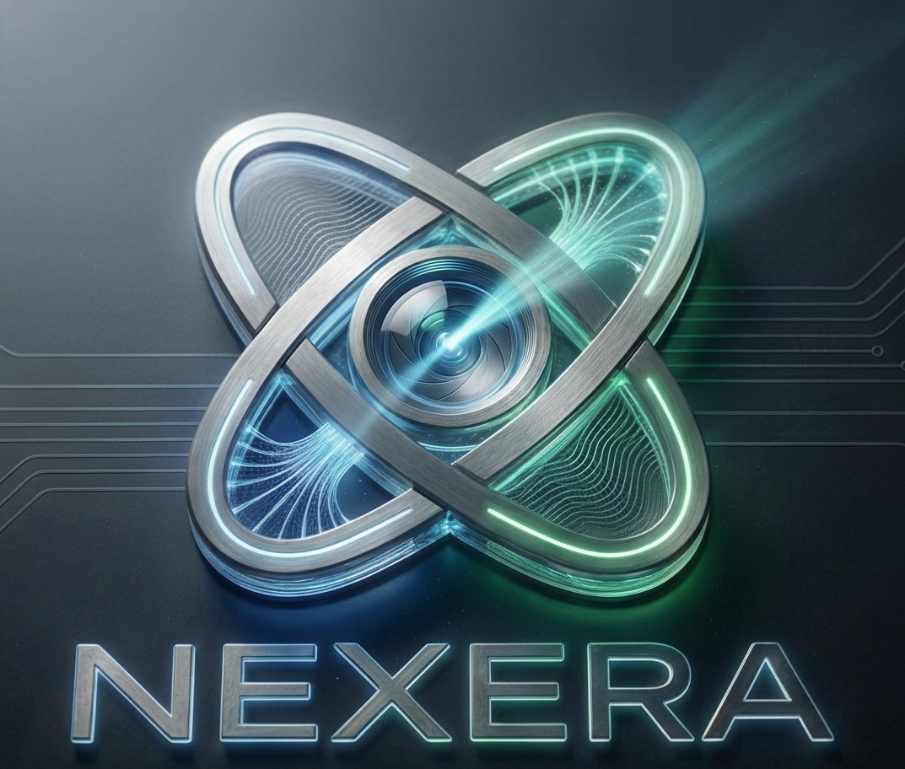
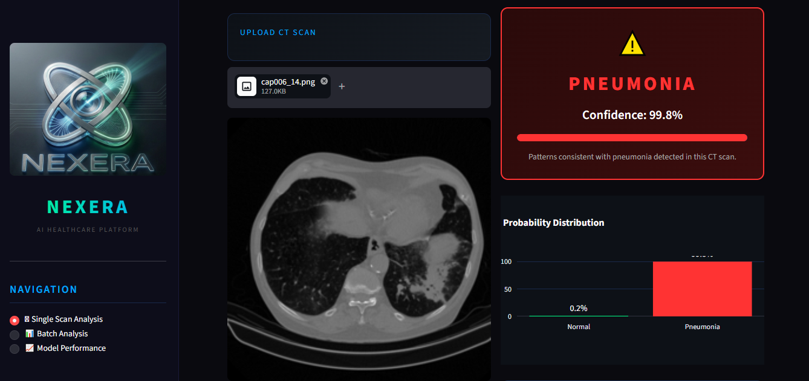

<p align="center">
  
</p>

<h1 align="center">NEXERA Lungs</h1>
<p align="center">AI-powered lung CT scan analysis, part of the NEXERA clinical intelligence platform</p>

---

## Overview

NEXERA Lungs is a deep learning system that analyses lung CT scans and classifies them using a fine-tuned **MobileNetV2** model. It comes with a **Streamlit dashboard** so clinicians and reviewers can upload scans and see predictions instantly.

It is one module of **NEXERA**, an AI medical imaging diagnostics platform that also covers brain MRI and diabetic retinopathy.

## Dashboard Preview




## Features

- **Single Scan Analysis**: upload one CT scan and get a prediction with confidence
- **Batch Analysis**: analyse multiple scans in one go
- **Model Performance**: view the model's evaluation metrics

## Tech Stack

- Python 3.11
- TensorFlow / Keras (MobileNetV2)
- Streamlit

## Project Structure

```
NEXERA-Lungs/
├── app.py
├── model/
│   └── nexera_mobilenet.keras
├── utils/
│   ├── prediction.py
│   └── preprocessing.py
├── nexera_logo.png
└── requirements.txt
```

## How to Run

```bash
git clone https://github.com/SeyonAnn/NEXERA-LUNGS.git
cd NEXERA-LUNGS
pip install -r requirements.txt
streamlit run app.py
```

## Results

- Task: binary classification of lung CT scans (Normal vs Pneumonia)
- Model: MobileNetV2 (frozen base, transfer learning)
- Test accuracy: **97.97%**
- Dataset: balanced lung CT dataset (harshkumarcn005/pneumonia-ct-scan-image-dataset)

## Disclaimer

This is a research prototype built for hackathon demonstration. It is **not** a certified medical device and must not be used for clinical diagnosis.

## Team

Built by Team NEXERA.
